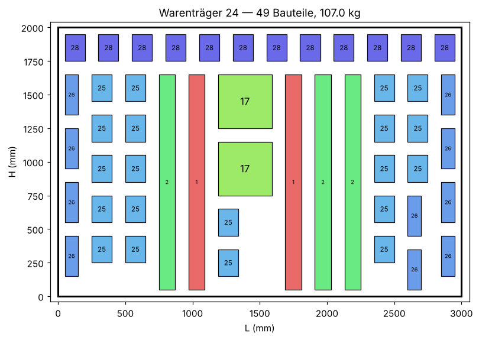

# Warenträger Packing Tool

Desktop Werkzeug in Python, das berechnet, wie viele Warenträger einer Lackieranlage pro Tag nötig sind und welche Bauteile auf welchen Träger gehängt werden. Ziel ist eine möglichst platzsparende Bestückung, die gleichzeitig praktische Regeln der Lackiererei einhält.



*Beispielausgabe auf erfundenen Daten: Träger 24 von 26 im Modus Frei (Träger 3000 x 2000 mm, Abstand 100 mm).*

## Problem

In einer Lackiererei hängen Bauteile an Warenträgern eines Hängefördersystems. Jeder Träger hat eine begrenzte Länge und Höhe. Die Teile hängen von oben und werden von beiden Seiten lackiert, deshalb zählt für die Anordnung nur die Fläche aus Länge und Höhe, die Tiefe dient als Prüfwert. Gesucht ist die Anzahl der Träger pro Tag und eine Belegung, die folgende Regeln erfüllt:

* Mindestabstand zwischen den Bauteilen (Pendelfreiheit) und zum Trägerrand
* Gleiche Bauteile hängen immer gleich ausgerichtet, rechteckige Teile bevorzugt hochkant
* Gewichtsbalance links und rechts innerhalb von 25 Prozent Abweichung
* Schwerere Teile tendenziell weiter unten, Ankerpunkt der Teile ist die Trägeroberkante
* Optional eine Neigung der Teile (Grad), damit die Farbe besser abläuft
* Je nach Wunsch frei optimiert, in Chargen gleicher Teile oder streng in der Reihenfolge der Teileliste

## Eingaben und Ausgaben

**Eingaben**

* Excel Teileliste mit festem Layout (Beispiel: `examples/beispiel_teileliste.xlsx`). Ab der Zelle "Part No." folgen die Spalten Part No., L, B, H (mm), Gewicht je Stück (kg), optional ein Trägervorschlag (W, H) und die Stückzahl je Maschine. Zwischen der Überschrift und den Daten liegen eine Unterüberschrift und eine Leerzeile. Die zwei größten Maße eines Teils bilden die Fläche auf dem Träger, das kleinste Maß wird gegen die Trägertiefe geprüft.
* Parameter in der Oberfläche: Trägerlänge, Trägerhöhe, Trägertiefe, Abstand zwischen Bauteilen, Abstand zum Trägerrand, Maschinen pro Tag, Neigungswinkel, Reihenfolge Modus (Frei, Chargenweise, Strikte Listenreihenfolge) und die Option Maschinentrennung.

**Ausgaben**

* In der Oberfläche: benötigte Träger pro Tag, Gesamtgewicht, schwerster Träger, Warnungen, dazu eine blätterbare 2D Zeichnung je Träger mit Gewichtsbalance und Teiletabelle.
* Excel Export: Parameter, Zusammenfassung und ein Blatt je Träger.
* PowerPoint Export: Deckblatt mit allen Parametern und Ergebnissen, danach eine Folie je Träger. Jedes Bauteil ist ein eigenes, editierbares Rechteck mit Maßen, dazu Skala und Bemaßung der Abstände.
* PNG Datei je Träger. Dateinamen enthalten Datum und Modus Kürzel, zum Beispiel `20261120-Zeichnungen-FO.pptx`.

## Ansatz und Begründung

Das Problem ist ein 2D Bin Packing mit Zusatzbedingungen und damit NP schwer. Eine exakte Lösung (zum Beispiel mit ganzzahliger Optimierung) skaliert bei hunderten Teilen und mehreren Nebenbedingungen schlecht und ist für Praktiker schwer nachzuvollziehen. Deshalb arbeitet das Tool mit einer mehrstufigen Heuristik, die in Millisekunden bis wenigen Sekunden rechnet, deterministisch ist und sich gut erweitern lässt.

1. **Vorverarbeitung:** Aus den drei Maßen werden die zwei größten als Fläche genommen. Jeder Bauteiltyp bekommt eine feste Ausrichtung für den ganzen Lauf.
2. **Reihen und Spalten (Shelf Verfahren):** Die Träger werden von oben nach unten in Reihen gefüllt, jede Reihe mittig ausgerichtet. Kleine Teile nutzen die Resthöhe über niedrigeren Teilen derselben Spalte. Sehr schwere, breite Teile bekommen eine eigene zentrierte Reihe.
3. **Verdichten:** Bevor ein Träger als voll gilt, wird geprüft, ob eine dichtere Neuanordnung noch ein weiteres Teil aufnimmt. Am Ende werden schwach gefüllte Träger zusammengelegt (bei Frei und Chargenweise).
4. **Modi:** *Frei* löst Reihenfolge und Gruppierung auf. *Chargenweise* hält gleiche Teile zusammen und probiert mehrere Chargenreihenfolgen plus eine lokale Tauschsuche. *Strikte Listenreihenfolge* verletzt die Reihenfolge der Trägerzuordnung nie. Mit *Maschinentrennung* wird nur eine Maschine gepackt und das Ergebnis mit der Zahl der Maschinen multipliziert (Ausfallsicherheit), sonst gilt die gesamte Tagesmenge als eine Menge.
5. **Nachbearbeitung in fester Rangfolge:** Zuerst zählt die Zahl der Träger, danach die Ausrichtung, dann die Gewichtsbalance (Spaltentausch, notfalls Verschieben auf den nächsten Träger), zuletzt die Symmetrie. Ein späteres Ziel verschlechtert ein früheres nie.
6. **Neigung:** Gleich geneigte Nachbarteile ändern ihren Abstand zueinander nicht, nur der starre Trägerrand braucht mehr Platz. Pro Träger wird deshalb ein Zusatzabstand zum Rand aus der Sehnengeometrie des größten Bauteils berechnet (Höhe beziehungsweise Breite mal tan(Winkel/2), nur wenn das Maß über 500 mm liegt). Damit dieser Wert nie nachträglich wächst, werden bei Frei und Chargenweise die größten Teile zuerst einsortiert.

Die Regeln sind als Invarianten formuliert und im Smoke Test abgesichert (keine Überlappung, Abstände, Ränder, vollständige Stückzahl, Listenreihenfolge).

## Start

Voraussetzungen: Python 3.10 oder neuer (genutzt unter Python 3.13 auf Windows), Tkinter (bei Windows enthalten, unter Linux Paket `python3-tk`).

```
python -m venv venv
venv\Scripts\activate          # Linux und macOS: source venv/bin/activate
pip install -r requirements.txt
python run.py
```

In der Oberfläche "Teileliste wählen" klicken und `examples/beispiel_teileliste.xlsx` öffnen. Die Trägergröße wird aus der Datei vorgeschlagen und kann überschrieben werden.

Ohne Oberfläche, zum Beispiel in einem Skript:

```python
from app.excel_io import read_parts
from app.packing import compute_packing

parts, issues = read_parts("examples/beispiel_teileliste.xlsx")
result = compute_packing(
    parts, rack_l=3000, rack_h=2000, rack_b=1000, item_gap=100, edge_margin=50,
    maschinen_pro_tag=3, reihenfolge_modus="frei", maschinentrennung=False,
    neigungswinkel_grad=0,
)
print(result.rack_count_display, "Träger pro Tag")
```

Tests: `python tests/test_smoke.py`. Eigenständige Windows Datei: `pip install pyinstaller`, danach `pyinstaller Warentraeger-Packing-Tool.spec`.

## Ergebnisse

Gemessen mit den erfundenen Beispieldaten (30 Bauteiltypen, 152 Stück je Maschine, 456 Stück pro Tag, Träger 3000 x 2000 x 1000 mm, Bauteilabstand 100 mm, Randabstand 50 mm, 3 Maschinen pro Tag):

| Modus | ohne Maschinentrennung | mit Maschinentrennung | mit 3 Grad Neigung (ohne / mit Trennung) |
|---|---|---|---|
| Frei | 26 Träger | 27 Träger | 28 / 30 |
| Chargenweise | 30 Träger | 30 Träger | 36 / 36 |
| Strikte Listenreihenfolge | 34 Träger | 39 Träger | 40 / 45 |

* Als Vergleich dient eine einfache Referenz, bei der jeder Bauteiltyp auf eigenen Trägern hängt: 43 Träger pro Tag. Die freie Optimierung kommt auf 26 Träger, das sind rund 40 Prozent weniger.
* Die reine Flächenuntergrenze liegt bei 18 Trägern. Sie ignoriert Abstände und Geometrie und ist nicht erreichbar.
* Flächenauslastung der Träger: 63 Prozent bei Frei, 55 Prozent bei Chargenweise, 48 Prozent bei Strikter Listenreihenfolge.
* Gewichtsbalance: größte Abweichung zwischen links und rechts 17,9 Prozent bei Frei ohne Neigung, Grenze ist 25 Prozent.
* Rechenzeit: Frei und Strikte Listenreihenfolge unter 0,2 Sekunden, Chargenweise 0,4 bis 3,5 Sekunden.

**Grenzen**

* Heuristik, keine garantiert optimale Lösung. Andere Teilelisten können anders abschneiden.
* Chargenweise ohne Maschinentrennung bündelt nicht in jedem Fall besser als die dreifach wiederholte Einzelmaschinenlösung. Im Beispiel sind beide gleich (30 Träger).
* Die Neigung ist ein vereinfachtes Modell: Rechtecke bleiben achsenparallel, der Zusatzabstand gilt nur zum Rand und erst ab 500 mm. Sie kostet im Beispiel 2 bis 6 Träger.
* Nur 2D. Die Tiefe wird nur geprüft, Teile werden als Rechtecke ohne Kontur behandelt, die Ausrichtung ist je Bauteiltyp fest.
* Das Excel Layout ist fest, andere Layouts werden nicht automatisch erkannt.
* Die Oberfläche wurde nur unter Windows genutzt und nicht automatisiert getestet. Der Smoke Test läuft unter Linux mit Python 3.10 und 3.13, unter Windows wurde er noch nicht ausgeführt.
* Die Zahlen stammen aus erfundenen Daten und sagen nichts über reale Aufträge. Eine Validierung gegen reale Aufhängungen steht aus.
* Der Testumfang ist klein. Umfangreichere Stresstests aus der Entwicklung sind nicht Teil dieses Repositories.

## Projektstruktur

```
app/            Oberfläche, Packalgorithmus, Excel Ein und Ausgabe, PowerPoint Export, Zeichnung
examples/       erfundene Beispiel Teileliste und Skript, das sie erzeugt
tests/          Smoke und Invariantentest
run.py          Einstiegspunkt (auch für PyInstaller)
```

## Autor und Kontext

Maro Schmitt Rodrigues. Das Tool entstand als Auftragsarbeit für einen Lackierbetrieb. Kunden, Aufträge und echte Maße sind entfernt, alle Beispieldaten sind erfunden.
